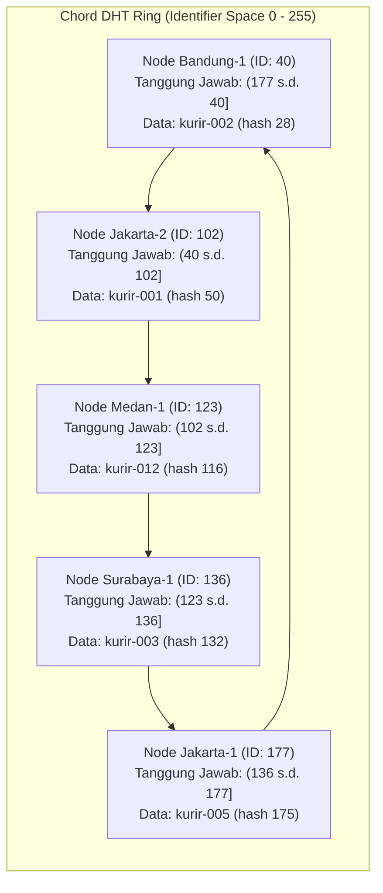

# Tugas 6 (Pekan 6) — Penamaan & Resolusi Lokasi

**Materi terkait:** Flat Naming, Structured Naming (DNS), Distributed Hash Table (DHT)/Chord.

## Studi Kasus

Pelanggan FoodGo kesulitan menemukan alamat IP server kurir yang **dinamis** (kurir berpindah lokasi/jaringan, IP-nya sering berubah). FoodGo butuh cara memetakan **ID Kurir** (identitas tetap) ke **alamat IP terkininya** tanpa server pusat tunggal yang jadi bottleneck/single point of failure.

## Tugas Kelompok

Implementasikan **simulasi Chord DHT** sederhana (single-process, tidak perlu jaringan sungguhan — cukup simulasi struktur data & algoritma di satu program Python) yang memetakan ID Kurir ke alamat IP mereka.

Konsep yang harus terlihat jalan dalam simulasi kalian:
1. **Consistent hashing**: ID Kurir dan ID Node di-hash ke ruang angka yang sama (mis. 0–255 untuk kesederhanaan, `m=8` bit).
2. **Ring topology**: node-node diurutkan melingkar berdasarkan hasil hash-nya.
3. **Lookup**: fungsi `lookup(kurir_id)` yang menemukan node mana yang bertanggung jawab menyimpan mapping ID Kurir tersebut → alamat IP-nya (aturan Chord: node dengan ID hash **terkecil yang lebih besar atau sama dengan** hash key, disebut *successor*).
4. **Perubahan topologi**: simulasikan minimal satu node baru bergabung (`join`) atau satu node keluar (`leave`), tunjukkan bagaimana mapping berpindah tanggung jawab ke node lain.

Skeleton disediakan di `src/chord_simulation.py` dengan fungsi hashing dan struktur ring sudah ada — bagian `lookup()`, `join()`, dan `leave()` sengaja dikosongkan.

### Cara Menjalankan

```bash
python3 src/chord_simulation.py
```

## Tugas Analisis (`README.md`)

1. Jelaskan **kenapa DHT/Chord** lebih cocok untuk kasus ini dibanding **flat naming sederhana** (mis. tabel pusat ID→IP) atau **DNS konvensional** — kaitkan dengan sifat "IP kurir sering berubah" dan kebutuhan tanpa titik gagal tunggal.
2. Gambarkan (boleh pakai Mermaid, lihat Tugas 2) ring topology dari simulasi kalian, tandai node mana yang bertanggung jawab atas ID Kurir mana.
3. Jelaskan apa yang terjadi pada mapping saat sebuah node **keluar** dari ring (siapa yang mengambil alih tanggung jawabnya) — dukung dengan output program.

### 1. Kenapa DHT/Chord Lebih Cocok Dibanding Flat Naming Sederhana & DNS Konvensional

Kasus FoodGo memiliki karakteristik alamat IP kurir yang **sangat dinamis** (sering berpindah jaringan/lokasi) dan menuntut ketersediaan tinggi tanpa titik gagal tunggal (*Single Point of Failure*).

* **Kelemahan Flat Naming Sederhana (Tabel Pusat ID → IP):**
  * **Titik Gagal Tunggal (SPoF):** Jika server database pusat mengalami *crash* atau gangguan jaringan, seluruh layanan pencarian kurir lumpuh total.
  * **Bottleneck Trafik:** Seluruh pembaruan IP dari ratusan kurir dan ribuan *lookup* dari pelanggan diarahkan ke satu titik yang sama, menyebabkan antrean dan latensi tinggi.
* **Kelemahan DNS Konvensional:**
  * **Masalah Caching & TTL:** DNS dirancang dengan sistem *caching* berjenjang (browser, OS, resolver ISP) yang mengandalkan nilai *Time To Live* (TTL). Karena IP kurir berubah cepat, *cache* akan sering menyimpan data lama (*stale IP*), sehingga pelanggan gagal menghubungi kurir.
  * **Inefisiensi TTL Rendah:** Memaksa TTL bernilai sangat kecil (misal 0–5 detik) menghilangkan fungsi efisiensi *caching* DNS dan membebani server DNS utama secara berlebihan.
* **Keunggulan DHT/Chord:**
  * **Terdesentralisasi Penuh:** Mapping data disebar merata ke berbagai node dalam ring menggunakan *consistent hashing*. Tidak ada satu server pun yang menjadi titik kegagalan tunggal.
  * **Reorganisasi Minimal saat Skala Berubah:** Ketika ada penambahan (*join*) atau pengurangan (*leave*) node, hanya kunci yang bersinggungan langsung dengan *successor* terkait yang dipindahkan ($O(K/N)$ data). Sistem tidak perlu me-rehash seluruh basis data.
  * **Pembaruan Langsung:** Update IP kurir langsung tercatat pada node yang bertanggung jawab saat itu juga tanpa terhambat *caching* perantara.

---

### 2. Ring Topology & Pemetaan Tanggung Jawab

Simulasi menggunakan ruang pengenal m = 8 bit (nilai ID 0 - 255).

* **Node Aktif:**
  * `node-bandung-1` (id = 40)
  * `node-jakarta-2` (id = 102)
  * `node-medan-1` (id = 123) *(bergabung)*
  * `node-surabaya-1` (id = 136)
  * `node-jakarta-1` (id = 177) *(sebelum keluar)*



---

3. Jelaskan apa yang terjadi pada mapping saat sebuah node **keluar** dari ring (siapa yang mengambil alih tanggung jawabnya) — dukung dengan output program.

   Ketika sebuah node keluar dari topologi ring (*graceful leave*), seluruh data pemetaan kurir yang tadinya disimpan oleh node tersebut harus dialihkan ke *successor* barunya agar data tidak hilang.

   * **Bukti Output Terminal:**
     ```text
     --- Sebuah node keluar ---
     Node 'node-jakarta-1' (id=177) keluar dari ring
       PINDAH: kurir-005 (hash=175) dari node id=177 -> node id=40
     kurir-001 -> 192.168.1.10
     kurir-002 -> 192.168.1.11
     ```

   * **Mekanisme Pengalihan Tanggung Jawab:**
     1. **Kondisi Awal:** Sebelum keluar, `node-jakarta-1` (id=177) bertanggung jawab atas data pemetaan `kurir-005` (nilai hash = 175).
     2. **Penghapusan Node:** Ketika `leave("node-jakarta-1")` dijalankan, node 177 dihapus dari daftar node aktif ring, sehingga sisa node yang aktif adalah `[40, 102, 123, 136]`.
     3. **Pencarian Successor Baru (Wrap-around):**
        - Sistem mencari node dengan ID $\ge 175$ untuk menampung hash 175.
        - Karena tidak ada lagi node aktif dengan ID $\ge 175$, algoritma Chord melakukan *wrap-around* (melingkar kembali dari awal) ke node dengan ID terkecil pada ring, yaitu `node-bandung-1` (id=40).
     4. **Hasil:** Tanggung jawab `kurir-005` dialihkan ke `node-bandung-1` (id=40). Sementara itu, data kurir lainnya (`kurir-001` dan `kurir-002`) tetap berada di nodenya masing-masing dan proses *lookup* tetap berhasil.

## Struktur Submission

```
tugas-06-penamaan-dht/
├── README.md      # Analisis + diagram ring
├── JURNAL.md
├── src/
│   └── chord_simulation.py
└── bukti/          # Output program (screenshot/log) untuk skenario join & leave
```

## Rubrik Penilaian (Tugas 6)

| Komponen | Bobot | Kriteria |
|---|---|---|
| Implementasi lookup/join/leave benar | 35% | Consistent hashing & successor lookup sesuai aturan Chord |
| Bukti perubahan topologi (join/leave) | 25% | Output menunjukkan mapping berpindah dengan benar |
| Analisis kenapa DHT vs flat naming/DNS | 25% | Argumen spesifik ke kasus IP kurir dinamis, bukan definisi umum |
| Proses & kontribusi kelompok | 15% | `JURNAL.md`, commit history |

## Batasan Penggunaan AI (Level 2)

Kebijakan **Level 2 (AI Assisted Idea Generation & Structuring)** berlaku — lihat [`../RUBRIK-UMUM.md`](../RUBRIK-UMUM.md). Boleh bertanya konsep umum consistent hashing/Chord ke AI; **tidak boleh** meminta AI menuliskan isi `# TODO` di `src/chord_simulation.py` (`find_successor`, `join`, `leave`, dst). Catat pemakaian AI di "Log Penggunaan AI" pada `JURNAL.md`.

- `README.md` wajib menelusuri manual (langkah demi langkah) bagaimana `lookup()` menemukan successor untuk salah satu ID Kurir contoh yang dipakai di `chord_simulation.py` — bukan cuma menempelkan output program.
