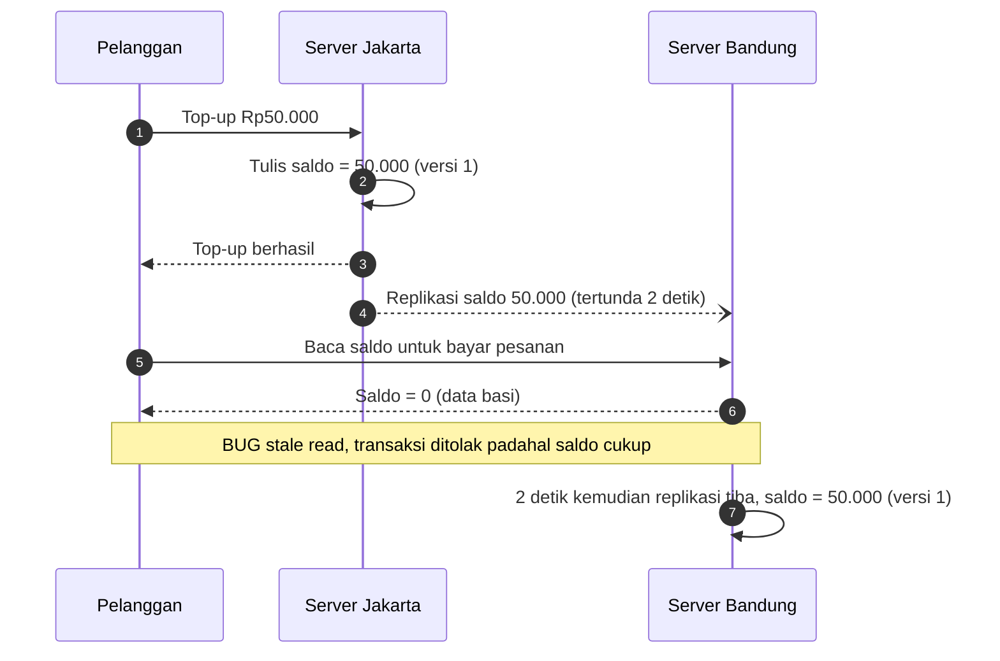
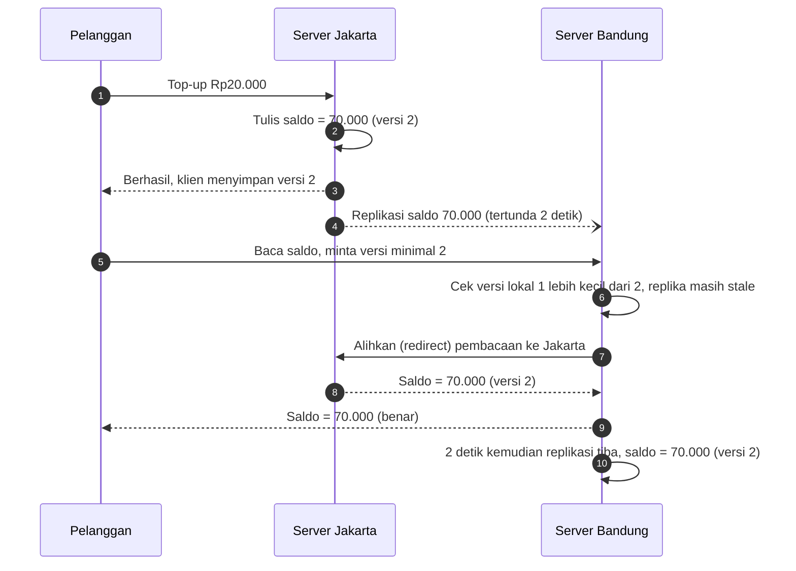

# Tugas 7 (Pekan 7) — Konsistensi Data

**Materi terkait:** Data-Centric Consistency (Sequential, Eventual), Client-Centric Consistency.

## Studi Kasus

Data saldo *e-wallet* pelanggan FoodGo berbeda antara server wilayah **Jakarta** dan **Bandung** karena replikasi antar server berjalan lambat. Contoh kasus nyata: pelanggan top-up saldo lewat server Jakarta, lalu dalam hitungan detik memesan makanan lewat aplikasi yang tersambung ke server Bandung — saldo belum ter-update, transaksi ditolak padahal saldo sebenarnya cukup.

## Tugas Kelompok

### Bagian 1 — Analisis (wajib)

1. Tentukan: apakah kasus ini **membutuhkan Sequential Consistency** (semua replika melihat urutan operasi yang sama) atau **cukup Eventual Consistency** (replika akan konsisten "pada akhirnya", boleh sementara berbeda)? Berikan argumen berbasis dampak bisnis (mis. kasus saldo *e-wallet* jauh lebih sensitif dibanding kasus "jumlah like" di media sosial).

Eventual Consistency saja tidak cukup, karena saldo e-wallet membutuhkan Sequential Consistency untuk operasi yang mengubah saldo (top-up, bayar, refund), sedangkan Eventual Consistency hanya layak untuk data non-kritis.
 
Argumen berbasis dampak bisnis:
 
- **Terkait uang:** Saldo stale membuat transaksi ditolak padahal saldo cukup (pesanan hilang, pelanggan kesal, beban CS naik). Sebaliknya, replika yang masih melihat saldo lama bisa membiarkan saldo dipakai dua kali (*double spending*, kerugian uang).
- **Urutan operasi menentukan hasil:** Top-up 50rb lalu bayar 40rb berbeda hasilnya dengan bayar dulu lalu top-up. Semua replika harus menerapkan urutan yang sama.
- **Biaya sepadan:** Tambahan latensi puluhan sampai ratusan milidetik jauh lebih murah daripada kehilangan pesanan dan kepercayaan pelanggan.
**Mengapa saldo e-wallet jauh lebih sensitif daripada "jumlah like" di media sosial:**
 
| Aspek | Saldo e-wallet | Jumlah like |
|---|---|---|
| Sifat data | Nilai uang nyata milik pelanggan | Angka popularitas, tidak punya nilai uang |
| Kebenaran data | Harus tepat (selisih Rp1 pun salah) | Boleh perkiraan (1.203 atau 1.205 sama saja bagi pembaca) |
| Keputusan yang bergantung pada data | Sistem mengambil keputusan dari angka ini: pembayaran diterima atau ditolak | Hanya ditampilkan, tidak memicu keputusan penting |
| Akibat jika stale | Pesanan batal, saldo terpakai dua kali, perlu refund dan penelusuran manual | Tidak ada akibat, angka menyusul sendiri beberapa detik kemudian |
| Bisa diperbaiki diam-diam? | Tidak. Pelanggan sudah terlanjur mengalami penolakan atau kehilangan uang | Ya, tidak ada yang menyadari |
| Dampak ke kepercayaan | Satu kejadian cukup membuat pelanggan meninggalkan aplikasi, dan ada risiko komplain serta regulasi uang elektronik | Hampir tidak ada |
| Urutan operasi | Penting (top-up lalu bayar tidak sama dengan bayar lalu top-up) | Tidak penting, like hanya dijumlahkan |
 
Pada saldo kesalahan kecil dan sementara pun berubah menjadi kerugian nyata yang tidak bisa ditarik kembali, sedangkan pada jumlah like kesalahan sementara akan hilang dengan sendirinya tanpa kerugian. Karena itu like cukup memakai Eventual Consistency, tetapi saldo tidak.
 
| Data FoodGo | Model |
|---|---|
| Saldo e-wallet, status pembayaran | Sequential (write terurut) |
| Rating, jumlah ulasan, menu, lokasi driver | Eventual |

2. Jika kalian menyimpulkan Eventual Consistency saja **tidak cukup** untuk skenario ini, usulkan pendekatan **Client-Centric Consistency** yang relevan (mis. *Read-Your-Writes*: pelanggan yang baru top-up harus selalu melihat saldo terbarunya sendiri, walau replika lain belum sinkron).

### Usulan: Read-Your-Writes (Client-Centric Consistency)

Sequential Consistency global menambah latensi karena setiap penulisan harus disinkronkan ke semua replika. Jalan tengahnya adalah **Read-Your-Writes**: pelanggan yang baru menulis (top-up) dijamin selalu membaca hasil tulisannya sendiri, meskipun replika lain belum sinkron.
 
Cara kerja:
 
1. Setiap penulisan saldo menaikkan nomor versi, dan klien menyimpan versi terakhir yang ia tulis (misalnya versi 2).
2. Saat klien membaca dari replika mana pun (misalnya Bandung), ia menyertakan versi minimal yang ia butuhkan.
3. Jika versi di replika lebih rendah, pembacaan dialihkan (*redirect*) ke server yang sudah memuat tulisan itu (Jakarta), sehingga saldo yang terbaca selalu benar.
Dampaknya, kasus pelanggan yang top-up lewat Jakarta lalu memesan lewat Bandung tidak lagi ditolak. Tambahan latensi hanya terjadi pada pembacaan yang replikanya masih basi, bukan pada setiap operasi.
 
Keterbatasan: jaminan ini hanya berlaku bagi klien yang menulis. Pihak lain bisa melihat data lama sampai replikasi selesai. Pengecekan dan pengurangan saldo saat pembayaran tetap harus dilakukan di server yang memegang data terbaru agar tidak terjadi pembelanjaan ganda.
 

3. Gambarkan **diagram alir urutan (sequence diagram)** yang menunjukkan operasi read/write antara pelanggan, server Jakarta, server Bandung, dan proses replikasi — untuk skenario **tanpa** jaminan konsistensi (bug terjadi) DAN skenario **dengan** solusi yang kalian usulkan (bug teratasi). Pakai Mermaid (`sequenceDiagram`) di `README.md` — lihat contoh cara pakai di Tugas 2.

**a. Tanpa jaminan konsistensi (bug terjadi)**



**b. Dengan solusi Read-Your-Writes (bug teratasi)**


## Skenario Tambahan: Studi Kasus Aplikasi Ojek Online

Untuk skenario tambahan ini, kami membuat analisis studi kasus menggunakan **aplikasi ojek online** (seperti Gojek atau Grab). Kita asumsikan aplikasi ini berjalan dengan dua server regional, misalnya di Jakarta dan Surabaya. Tujuannya adalah untuk menunjukkan bahwa di dalam satu aplikasi yang sama, kita bisa menerapkan **model konsistensi data yang berbeda-beda**, tergantung seberapa besar dampak bisnis dari data tersebut.

### Kasus A: Penugasan Orderan ke Driver (*Order Assignment*)

**Masalah:** 
Bayangkan ada satu pesanan yang di-*blast* ke beberapa driver sekaligus. Lalu, ada dua driver yang memencet tombol "Terima" di waktu yang hampir bersamaan—satu driver nge-ping ke server Jakarta, dan satu lagi ke server Surabaya. Kalau sistemnya hanya mengandalkan *eventual consistency*, kedua server akan sama-sama melihat bahwa pesanan tersebut masih "tersedia". Akibatnya, pesanan malah masuk ke dua-duanya (*double assignment*).

**Model yang tepat: *Sequential / Strong Consistency***

*   **Dampak bisnis:** Kalau dibiarkan, dua driver akan datang ke satu titik jemput yang sama. Jelas salah satu driver akan rugi waktu dan bensin, yang berujung pada komplain. Penumpang juga pasti kebingungan, perusahaan harus keluar uang untuk kompensasi, dan reputasi aplikasi bisa turun.
*   **Alasan teknis:** Karena risikonya besar, operasi "terima pesanan" ini harus bersifat atomik (*compare-and-set*). Jadi, perubahan status dari `DITAWARKAN` menjadi `DITERIMA` hanya boleh berhasil untuk satu pemenang saja melalui satu server utama (*leader*). Dengan begitu, semua server akan melihat urutan data yang sama persis.

### Kasus B: Update Titik Lokasi Driver di Peta

**Masalah:** 
Titik ikon motor driver di peta penumpang terkadang *ngelag* atau tertinggal sekitar 1 sampai 3 detik dari lokasi aslinya.

**Model yang tepat: *Eventual Consistency***

*   **Dampak bisnis:** Dampaknya sangat kecil. Titik lokasi driver toh dikirim setiap beberapa detik, jadi data yang lama akan langsung tertimpa oleh data baru. Kalau kita memaksakan *strong consistency* di fitur ini, sistem justru bakal melambat dan boros biaya *resource* hanya untuk mengurus data yang cepat basi.
*   **Solusi tambahan:** Agar *user experience* tetap nyaman, kita bisa menambahkan **Monotonic Reads**. Tujuannya supaya ikon motor driver tidak pernah "melompat mundur" ke lokasi sebelumnya, apalagi kalau koneksi internet penumpang sedang tidak stabil atau berpindah jaringan.

### Kasus C: Status Pesanan di Layar Penumpang (*Client-Centric*)

Untuk kasus ini, kalau seorang penumpang baru saja membatalkan pesanannya, layar HP-nya harus saat itu juga menampilkan status "Dibatalkan". Jangan sampai layarnya masih menampilkan "Mencari driver" hanya karena server replikanya belum selesai sinkronisasi. 
Oleh karena itu, model yang tepat adalah **Read-Your-Writes**. Intinya, pengguna harus selalu bisa langsung melihat pembaruan data dari aksi yang baru saja dia lakukan sendiri.

---

**Ringkasan Analisis Skenario:**

| Jenis Data | Model Konsistensi | Alasan & Dampak Bisnis |
| :--- | :--- | :--- |
| **Penugasan driver ke pesanan** | *Sequential / Strong* | Mencegah *double assignment*. Kerugiannya bersifat langsung (waktu, bensin, kompensasi) dan merusak reputasi. |
| **Lokasi *live* driver** | *Eventual (+ Monotonic Reads)* | Datanya sangat cepat basi. Selisih beberapa detik tidak merugikan secara bisnis, asal tidak mundur ke belakang. |
| **Status pesanan milik penumpang** | *Client-centric: Read-Your-Writes* | Penumpang mutlak harus melihat hasil dari aksi yang baru saja ia lakukan (seperti *cancel* order). |

### Bagian 2 — Simulasi (opsional, nilai tambah)

Skeleton `src/replica_simulation.py` mensimulasikan dua replika (Jakarta & Bandung) dengan delay replikasi buatan. Lengkapi TODO untuk:
1. Menunjukkan kondisi **inconsistent read** (replika Bandung masih menunjukkan saldo lama walau Jakarta sudah update).
2. Mengimplementasikan mekanisme **Read-Your-Writes** sederhana (mis. dengan version/timestamp per client) yang memperbaiki masalah tersebut.

```bash
python3 src/replica_simulation.py
```

## Struktur Submission

```
tugas-07-konsistensi-data/
├── README.md      # Analisis konsistensi + sequence diagram Mermaid
├── JURNAL.md
├── src/            # (opsional) simulasi replikasi
└── bukti/          # (jika mengerjakan simulasi) output program
```

## Rubrik Penilaian (Tugas 7)

| Komponen | Bobot | Kriteria |
|---|---|---|
| Ketepatan pemilihan model konsistensi | 30% | Argumen berbasis dampak bisnis nyata, bukan hafalan definisi |
| Kualitas sequence diagram | 30% | Menunjukkan jelas titik kegagalan & titik perbaikan |
| Usulan solusi client-centric | 25% | Solusi konkret dan dapat diimplementasikan (bukan wacana abstrak) |
| Proses & kontribusi kelompok | 15% | `JURNAL.md`, commit history (+ bonus jika simulasi dikerjakan) |

## Batasan Penggunaan AI (Level 2)

Kebijakan **Level 2 (AI Assisted Idea Generation & Structuring)** berlaku — lihat [`../RUBRIK-UMUM.md`](../RUBRIK-UMUM.md). Boleh bertanya konsep umum consistency model ke AI untuk brainstorming; **tidak boleh** meminta AI menuliskan analisis akhir/sequence diagram atau isi `# TODO` di `src/replica_simulation.py` yang tinggal ditempel. Catat pemakaian AI di "Log Penggunaan AI" pada `JURNAL.md`.

- Sebagai bukti pemahaman konsep (bukan hafalan jawaban skenario FoodGo saja), `README.md` wajib menyertakan **satu skenario tambahan** yang kalian buat sendiri (mis. kasus lain di aplikasi ojek online) dan menentukan model konsistensi yang tepat untuk skenario tambahan tersebut.
